# How Explorer works, explained simply

**Who this is for:** anyone. You need no technical background.
**Reading time:** about 10 minutes.

> **Explorer in one sentence.** Explorer is a helper inside Vantage that learns your web application the way a sharp new tester would. It checks its understanding with you, tries every important task, and hands you tests it has *proven* work, along with a list of things that look wrong.

---

## Contents

1. [Why Explorer exists](#1-why-explorer-exists)
2. [Who is inside Explorer](#2-who-is-inside-explorer)
3. [The whole journey at a glance](#3-the-whole-journey-at-a-glance)
4. [Step 2 up close: getting to know the app](#4-step-2-up-close-getting-to-know-the-app)
5. [What Explorer is allowed to press](#5-what-explorer-is-allowed-to-press)
6. [How Explorer knows what is "correct"](#6-how-explorer-knows-what-is-correct)
7. [Step 5 up close: missions](#7-step-5-up-close-missions)
8. [When Explorer asks you something](#8-when-explorer-asks-you-something)
9. [Step 6 up close: finding hidden screens](#9-step-6-up-close-finding-hidden-screens)
10. [Step 7 up close: proving tests](#10-step-7-up-close-proving-tests)
11. [What you get at the end](#11-what-you-get-at-the-end)
12. [Common questions](#12-common-questions)
13. [Words used in these documents](#13-words-used-in-these-documents)

Throughout this guide we use one example: **an insurance app where agents report claims.**

---

## 1. Why Explorer exists

Before Explorer, Vantage discovered an app by clicking every link in order and typing "Test value" into every box. That had three problems:

| Problem | Example |
|---|---|
| **It missed screens that only appear sometimes** | A "Spouse details" step that appears only when you pick *Married*, or a "Manager approval" step for large claims. |
| **It got stuck where real data was needed** | A screen that only accepts a valid policy number. |
| **Its tests guessed what should happen** | If the app had a bug, the test simply copied the bug as "expected". |

Explorer fixes all three. It thinks before it clicks, asks when it can't guess, and never assumes the app is right.

---

## 2. Who is inside Explorer

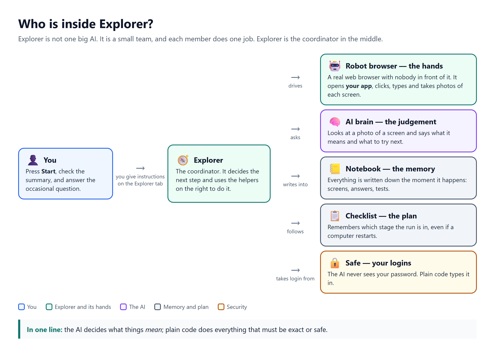

Explorer is a small team, not one big AI. Each member has a single job:

- **🤖 The robot browser (the hands).** This is a real web browser that no person sits in front of. Explorer controls it to open your app, click, type, and take a photo of every screen.
- **🧠 The AI brain (the judgement).** It looks at a photo of a screen and explains what it means and what is worth trying next. It comes in two sizes: a careful one for most decisions, and a quick one used only to pick the next place to visit.
- **📒 The notebook (the memory).** Everything is written down the moment it happens, including screens, photos, answers and tests. That is why you can watch live, and why nothing is lost if you pause.
- **📋 The checklist (the plan).** It remembers which stage the run is in, even if a computer restarts halfway through.
- **🔒 The safe (your logins).** Your app's password is locked away. The AI never sees it, and plain code types it in.

> **Remember this:** the AI decides what things *mean*. Plain code does everything that must be exact or safe.

---

## 3. The whole journey at a glance

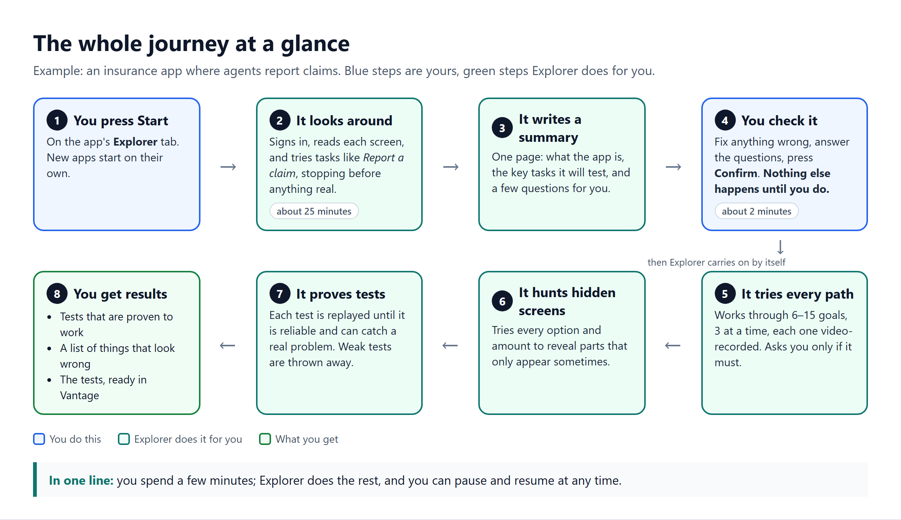

| Step | Who | What happens | How long |
|---|---|---|---|
| 1 | You | Press **Start exploring** on the app's Explorer tab. New apps start on their own. | a second |
| 2 | Explorer | Signs in, looks around, reads each screen, and walks through tasks, stopping before anything real. | about 25 minutes |
| 3 | Explorer | Writes a one-page **App Summary**: what the app is, the tasks it will test, and a few questions for you. | a minute |
| 4 | **You** | Read the summary, fix anything wrong, answer the questions, and press **Confirm**. Nothing else happens until you do. | about 2 minutes |
| 5 | Explorer | Works through 6–15 **missions** (goals), 3 at a time, each one video-recorded. It asks you only if it must. | depends on the app |
| 6 | Explorer | Hunts for **hidden screens** that only appear for certain choices. | up to 25 minutes |
| 7 | Explorer | Builds tests and **proves** each one. Weak tests are thrown away. | depends on the app |
| 8 | You | Get proven tests, a list of things that look wrong, and the tests ready in Vantage. | — |

You can **pause** at any point and **resume** later. Explorer carries on from exactly where it stopped, and nothing finished is lost. If Explorer needs you while you're away, it sends you an email.

---

## 4. Step 2 up close: getting to know the app

### How Explorer understands a screen

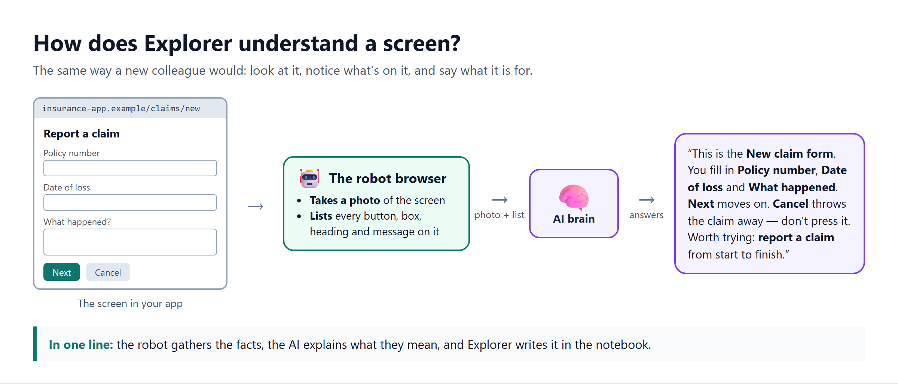

For every screen it visits:

1. The robot browser **takes a photo** and **makes a list** of everything on the page: buttons, boxes, headings and messages.
2. The AI brain gets both and describes the screen in plain words, as shown above.
3. Explorer writes that description in the notebook.

At the same time, the robot quietly notes **health problems**: pages that crash, server errors, broken links, pages slower than 6 seconds. Each problem takes points off a **health score** that starts at 100. If the score drops below 60, Explorer treats the app as unreliable and relies more on what you tell it.

### Why 1,000 customer pages count as one screen

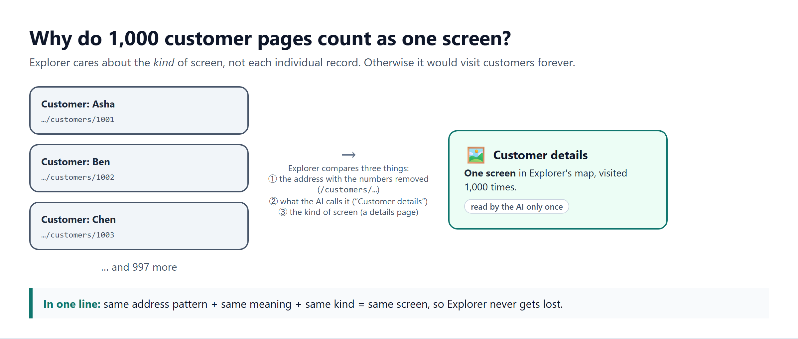

Explorer cares about the *kind* of screen, not each individual record. Two pages count as the same screen when all three of these match:

- their address, once the numbers are removed;
- what the AI calls them;
- what kind of page they are.

This keeps Explorer from wandering through customer records forever. It also saves time, because a screen it already knows isn't sent to the AI again.

### How Explorer chooses where to go next

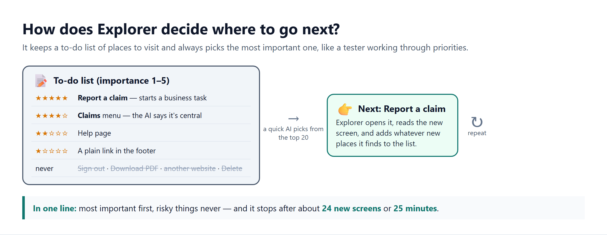

Explorer keeps a **to-do list** of places it hasn't visited yet:

- **Each place gets an importance score from 1 to 5.** Anything that *starts a task*, like "Report a claim", scores highest.
- **The quick AI picks the most important place** from the top 20.
- **Some places never go on the list:** sign-out, other websites, file downloads, and anything risky.

When Explorer finds a task, it walks through it step by step:

- **Typing:** it uses your test data first. Where it has none, it uses realistic made-up values.
- **Choices:** it notes every choice that might change the path, such as Married or Single.
- **Stopping point:** it stops before anything that would save, send or pay for real.

It stops looking around after about **24 new screens** or **25 minutes**, whichever comes first. Then it writes the App Summary (step 3) and waits for you (step 4).

---

## 5. What Explorer is allowed to press

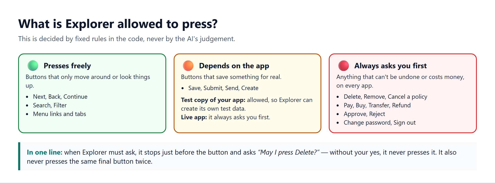

Safety is **not** left to the AI. It is a fixed list of words in the code:

- 🟢 **Moving around is always fine:** Next, Back, Search, menus.
- 🟠 **Saving depends on the app.** On a *test copy* of your app, Explorer may press Save or Submit so it can create its own test data. On a *live* app it always asks you first.
- 🔴 **Some buttons always need your OK, on every app.** These are buttons that can't be undone or that cost money: Delete, Pay, Approve, Reject, Transfer, Refund, Sign out and similar.

When it needs your OK, Explorer stops just before the button and asks *"May I press Delete?"*. Without your **yes**, it never presses it. It also never presses the same final button twice.

---

## 6. How Explorer knows what is "correct"

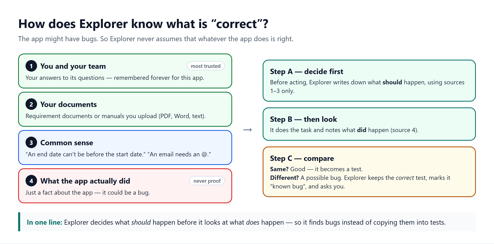

This is the most important idea in Explorer.

**The app might have bugs.** A tester who writes down whatever the app does and calls it "correct" ends up writing tests that *protect* the bugs. So Explorer works in this order:

1. **Decide first.** Before trying anything, it writes down what *should* happen. It uses only:
   - your answers;
   - your documents;
   - common sense.
2. **Then look.** It does the task and notes what *did* happen.
3. **Compare.**
   - If they match, good.
   - If they differ, that's a **possible bug**. Explorer keeps the *correct* test, marks it "known bug", and asks you whether it's really a bug.

What the app does is treated as **evidence, never as proof**.

---

## 7. Step 5 up close: missions

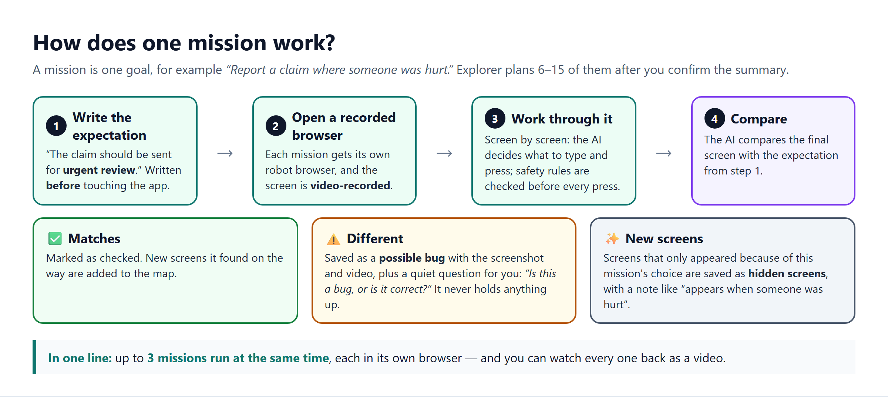

After you confirm the summary, Explorer turns it into **6 to 15 missions**. There are four kinds:

| Kind | Example |
|---|---|
| **A key task** | "Report a claim from start to finish" |
| **A different path** | "Report a claim where someone was hurt" |
| **A part not seen yet** | "Look at the Reports area" |
| **A rule check** | "Check that a claim dated in the future is refused" |

Each mission:

1. Writes down what **should** happen.
2. Opens its **own robot browser** and records a **video**.
3. Works through the task screen by screen. Safety rules are checked before every press.
4. Compares the result with the expectation. A mismatch becomes a **possible bug**, with a screenshot and the video.

Three missions run at the same time. Some apps keep saved progress, like drafts or a shopping cart. For those, Explorer runs missions **one at a time** so they don't interfere with each other.

You can watch every mission back as a video.

---

## 8. When Explorer asks you something

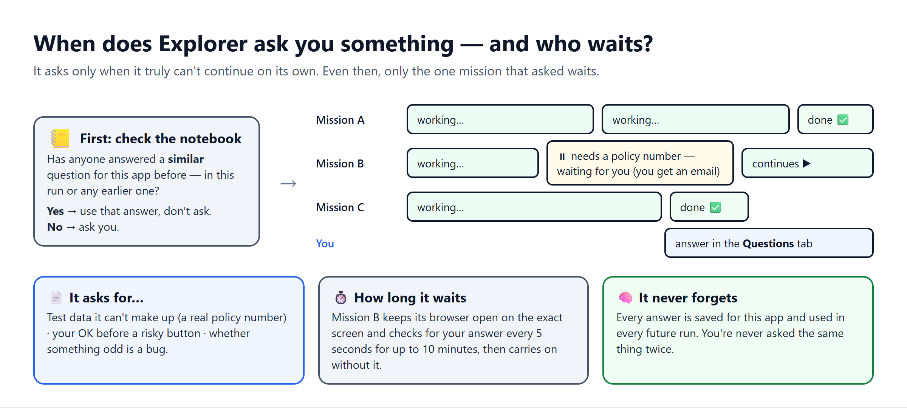

Explorer asks only when it truly can't continue. There are three kinds of question:

| Kind | Example | Does anything wait? |
|---|---|---|
| **Test data it can't invent** | "Which policy number should I use?" | Only that one mission |
| **Your OK** | "May I press *Approve*?" | Only that one mission |
| **"Is this a bug?"** | "A claim of 50,000 went through with no approval. Is that right?" | **Nothing.** These never hold anything up. |

How it works:

- **It checks its memory first.** If anyone answered a *similar* question for this app before, in this run or any earlier one, it uses that answer and doesn't ask again.
- **Only the mission that asked waits.** It keeps its browser open on the exact screen and checks for your answer every 5 seconds for up to 10 minutes. Everything else keeps going.
- **You get an email**, and the question pulses in the **Questions** tab with clickable options and a screenshot.
- **Your answer is remembered forever** for this app. You can also upload documents (PDF, Word, text) or type facts, and Explorer treats them the same way.

---

## 9. Step 6 up close: finding hidden screens

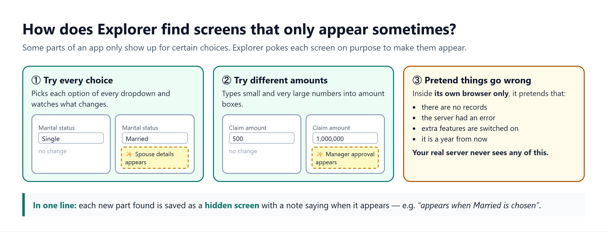

After the missions, Explorer goes back to screens it knows and tries to make hidden parts appear. It uses three tricks:

1. **Try every choice.** For each dropdown or radio button, it picks each option and watches for new fields.
2. **Try different amounts.** It types small and very large numbers into amount boxes and watches for new sections.
3. **Pretend things go wrong.** It pretends there are no records, that the server had an error, that extra features are on, or that it's a year from now. This happens only inside its *own* browser, and your real server never sees it.

Every new part it finds is saved as a **hidden screen**, with a note on when it appears, for example *"appears when Married is chosen"*.

If you've added other kinds of users, such as a viewer or an admin, Explorer also checks **who can see what**. It tries every screen as each of them.

---

## 10. Step 7 up close: proving tests

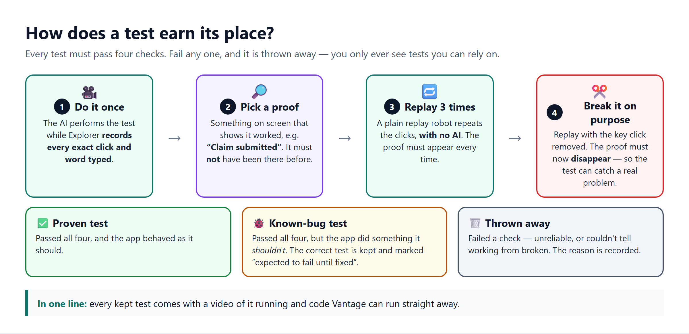

Explorer writes tests of five kinds:

- **Navigation:** can you get from here to there?
- **Validation:** does the form refuse wrong input?
- **Error states:** what happens when something goes wrong?
- **Data loading:** do lists and details show up?
- **Form submission:** does saving work?

It also adds simple page-quality checks: does the page load cleanly, are any images broken, does it fit a phone screen, does every box have a label.

**Every test must pass four checks.** Fail any one, and it is thrown away:

| Check | Why |
|---|---|
| 1. **Do it once** while recording every exact click and keystroke | So the test can be replayed precisely |
| 2. **Pick a proof** that wasn't on screen before, e.g. *"Claim submitted"* | So the test proves something actually happened |
| 3. **Replay it 3 times with no AI** | So the test is reliable, with the same result every time |
| 4. **Replay it with the key click removed**, where it must now fail | So the test can actually catch a broken app |

---

## 11. What you get at the end

| You get | Where you find it |
|---|---|
| **Proven tests**, each with steps, the expected result, a screenshot and a video of it running | Explorer tab → **Scenarios** |
| **Known-bug tests**: correct tests that fail today because the app is wrong | Explorer tab → **Scenarios** |
| **Things that look wrong**: possible bugs, each with a screenshot | Explorer tab → **What it learned**, at the bottom |
| **A map of screens**: every screen, what you can do on it, and where each action leads | Explorer tab → **Screens** |
| **Tests ready to run in Vantage**: press **Generate tests**, and Vantage uses the exact code Explorer already proved | Explorer tab → **Scenarios** → Generate tests |

---

## 12. Common questions

**Will Explorer break my app or change real data?**
No. On a live app it never saves anything without asking you. Dangerous buttons like Delete or Pay always need your OK, on any app. Its "what if the server fails" experiments happen only inside its own browser.

**Does the AI see my password?**
No. Logins are kept in a secure safe and typed in by plain code.

**What if I'm not around when it has a question?**
Only that one mission waits, for up to 10 minutes, and then carries on without the answer. Everything else keeps going. You also get an email.

**Will it ask me the same thing again next time?**
No. Every answer is remembered for that app, across all future runs.

**What if the app is buggy?**
Explorer is built for that. It decides what *should* happen before looking, so bugs show up as "things that look wrong" and "known-bug tests". They never become "expected behaviour".

**Can I stop it halfway?**
Yes. **Pause** and **Resume** carry on from where it left off. **Stop** ends the run, and it can still be resumed later.

**How do I teach it about my app?**
Answer its questions, type facts on the *What it learned* tab, or upload requirement documents. All of it becomes trusted knowledge for every future run.

---

## 13. Words used in these documents

| Word | Meaning |
|---|---|
| **Run** | One complete exploration of an app, from Start to tests. |
| **App Summary** | The one-page description Explorer writes for you to check and confirm. |
| **Mission** | One goal Explorer works on, e.g. "report a claim where someone was hurt". |
| **Hidden screen** | A screen or part of a screen that only appears in certain situations. |
| **Possible bug** | Something the app did that differs from what it should do. |
| **Proven test** | A test that passed all four checks, on an app that behaved correctly. |
| **Known-bug test** | A correct test that fails today because the app is wrong. |
| **Test copy / live app** | A test copy is where saving is allowed. A live app is the real one, where Explorer never saves without asking. |
| **Health score** | 0–100, based on crashes, errors, broken links and slow pages. |

**Want the technical details?** Start with [document 2, System architecture](02-system-architecture.md).
