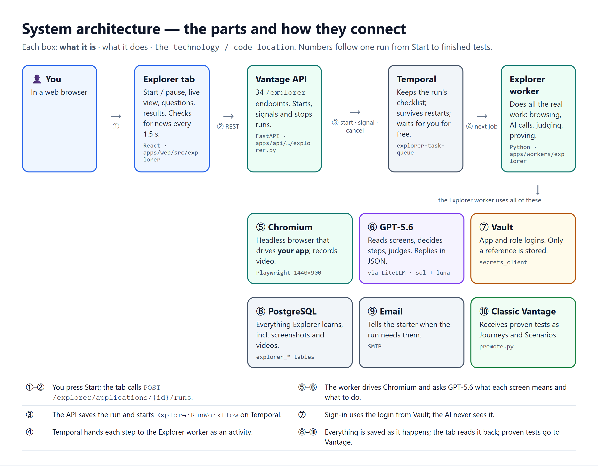

# 2. System architecture

> **In short.** You use the **Explorer tab** in the browser. It talks to the **Vantage API**, which hands the run to **Temporal**, a service that keeps the run's checklist. Temporal gives each step to the **Explorer worker**, a Python program that does the real work:
> - it drives a **headless Chrome** browser against your app;
> - it asks **GPT-5.6** what each screen means;
> - it reads logins from **Vault**;
> - it writes everything to **Postgres**.
>
> When it's done, proven tests are copied into **classic Vantage**.

## 1. The parts

| # | Part | In simple terms | Technology and code |
|---|---|---|---|
| — | **Explorer tab** | The screens you use: start, watch, answer, results | React + TypeScript · `apps/web/src/explorer/` |
| — | **Vantage API** | The front desk: receives your clicks and starts, signals or stops runs | FastAPI · `apps/api/src/api/explorer.py` (34 endpoints under `/explorer`) |
| — | **Discovery hook** | Makes new apps start Explorer automatically instead of the old crawler | `apps/api/src/api/discovery.py` · `EXPLORER_REPLACES_DISCOVERY` (default on) |
| — | **Temporal** | The checklist keeper: runs steps in order, survives restarts, and waits for you at no cost | Temporal server · task queue `explorer-task-queue` · workflow `ExplorerRunWorkflow` |
| — | **Explorer worker** | The worker that does everything: browsing, AI calls, judging, proving, handing over | Python · `apps/workers/explorer/` · 1 workflow + 16 activities |
| — | **explorer_core** | Shared definitions used by both the API and the worker | `packages/explorer_core/`: table models, status lists, Temporal names, the email helper |
| ⑤ | **Headless Chromium** | The robot browser | Playwright Chromium · 1440×900 · records `.webm` video |
| ⑥ | **GPT-5.6** | The AI brain, in two sizes | Through the company LiteLLM gateway. **Thinking** (`gpt-5.6-sol`) does almost everything. **Fast** (`gpt-5.6-luna`) only picks where to go next. Every reply is JSON. |
| ⑦ | **Vault** | The safe for logins | HashiCorp Vault via `secrets_client`. Only a reference (`secret_ref`) is stored in the database. |
| ⑧ | **PostgreSQL** | The notebook | All `explorer_*` tables, including screenshot and video bytes |
| ⑨ | **SMTP email** | Tells the person who started the run when it needs them | `smtplib`. Without `SMTP_HOST` the email is logged instead of sent. |
| ⑩ | **Classic Vantage** | Where proven tests end up | Journey / Scenario / TestSuite / TestAsset tables. The generation worker reuses Explorer's proven code. |
| — | **ffmpeg** (optional) | Makes the highlight video | ffmpeg plus a bold system font on the worker machine. Skipped if missing. |

## 2. How one run flows through the parts

These match the numbers in the picture.

1. **①–②** You press **Start exploring**. The tab calls `POST /explorer/applications/{id}/runs`.
2. **③** The API saves a new `explorer_run` row and starts `ExplorerRunWorkflow` on Temporal.
3. **④** Temporal hands the first step to the Explorer worker.
4. **⑤–⑦** The worker:
   - opens Chromium and signs in with the login from Vault;
   - visits screens and asks GPT-5.6 about each one.
5. **⑧** Every screen, event and photo is written to Postgres immediately. The tab checks for new events every 1.5 seconds and shows them live.
6. **⑨** When the App Summary is ready, the worker emails you, and the workflow waits for your **Confirm**.
7. Missions, the hidden-screen hunt, and test building follow the same pattern.
8. **⑩** At the end, proven tests are copied into classic Vantage.

Three things are worth knowing:

- **The API never calls the worker directly.** It only starts, signals or cancels the workflow, and reads and writes the database.
- **Answering a question needs no signal.** The API saves the answer, and the waiting mission notices it by checking the database every 5 seconds.
- **The worker writes classic Vantage rows itself** in the hand-off step. It does not go through the API.

## 3. Why it is built this way

| Decision | Reason |
|---|---|
| **A separate module** with its own worker, tables (`explorer_*`) and AI client | The old discovery keeps working untouched. Explorer reads only the `application` row and its saved login. |
| **Temporal workflow per run** | A run can last minutes or days and must wait for a person. Temporal waits for free (up to 14 days for confirmation), survives restarts, and makes Stop/Pause clean. |
| **No automatic retries** (`maximum_attempts=1`) | A half-finished browser session can't be safely repeated. Each step turns its own failure into a visible "failed" with a reason. A mission or test whose worker died gets **one** extra try. |
| **Everything written as it happens** | Gives you the live view, lets Pause/Resume pick up exactly where it stopped, and means no work is lost. |
| **The UI polls instead of using websockets** | Simple and stateless. Each event has a number, so the UI asks "anything after event 1234?" |
| **Screenshots and videos in Postgres** | No extra storage setup. This is marked as a `ponytail:` shortcut: move to the object store if runs grow to thousands of screenshots. |
| **Memory matched by keywords**, not vector search | Enough for a few hundred facts per app. Also marked `ponytail:`. |

## 4. Processes to run

| Process | How it starts |
|---|---|
| API | Existing Vantage API. The Explorer router is part of it. |
| Explorer worker | `uv run --env-file .env --package explorer-worker python -m explorer_worker.worker`. `scripts/dev-start` starts it for you (see [doc 8](08-operations-and-configuration.md)). |
| Web | Existing Vite dev server or build |

If no Explorer worker is running, pressing Start returns **503 `EXPLORER_UNAVAILABLE`**, and onboarding a new app records a failed discovery with reason `worker_unavailable`.

## 5. Security boundaries

- **Tenant isolation:** every endpoint checks that the run, mission, test, question or screenshot belongs to the caller's organization. Anything else returns 404. There are no finer role checks.
- **Logins never reach the AI.** Sign-in is done by code. Exported tests use `{{username}}`/`{{password}}` placeholders that the test project fills in from its own config.
- **Simulated server problems** (doc 1, section 9) are intercepted inside Explorer's own browser. Nothing is sent to the real server.
