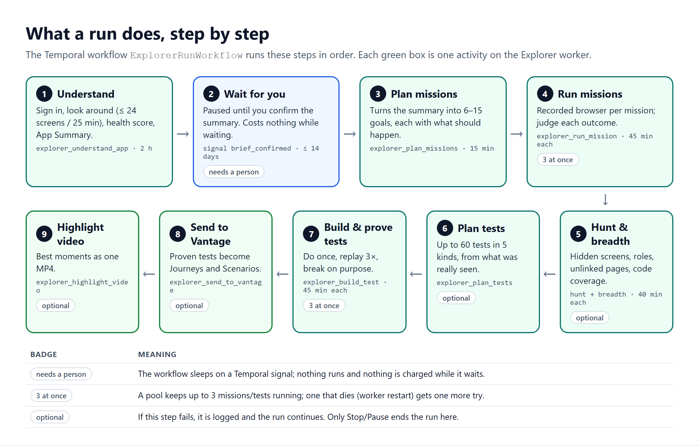
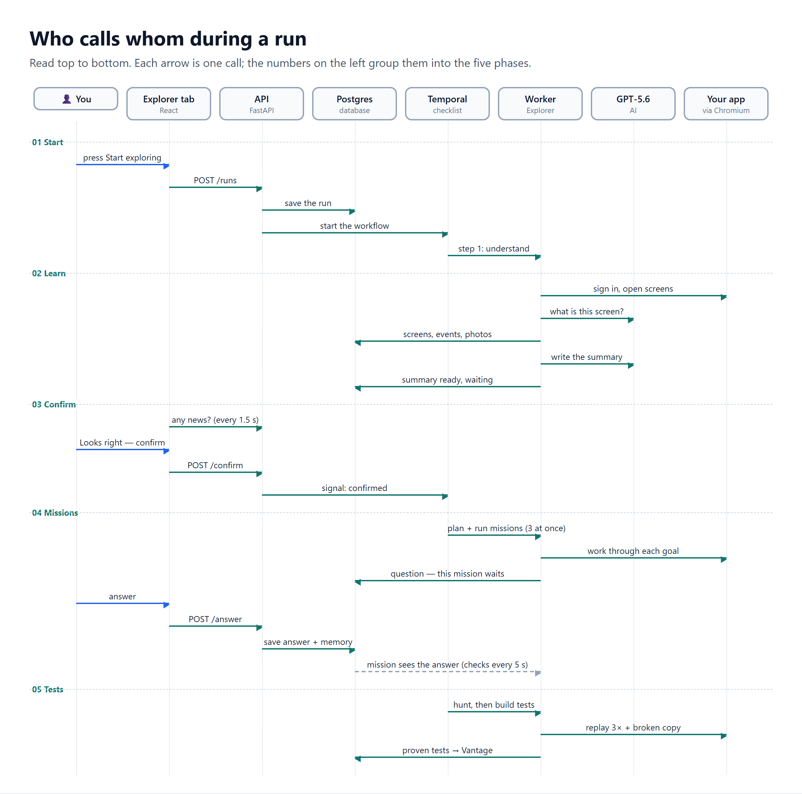
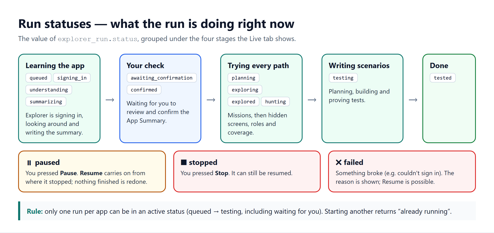

# 3. Technical flow

> **In short.** Each run is one Temporal workflow, `ExplorerRunWorkflow`. It runs nine steps in a fixed order. Step 2 is a pause where it waits for you to confirm the App Summary. The two busiest steps, missions and tests, run up to three items at once. Any step can be paused and resumed, because everything is saved to the database as it happens.

**Contents:**
1. [The steps of a run](#1-the-steps-of-a-run)
2. [Who calls whom](#2-who-calls-whom)
3. [Statuses](#3-statuses)
4. [How a run starts](#4-how-a-run-starts)
5. [The confirmation pause](#5-the-confirmation-pause)
6. [Questions during missions](#6-questions-during-missions)
7. [Pause, stop and resume](#7-pause-stop-and-resume)
8. [When something fails](#8-when-something-fails)

---

## 1. The steps of a run

| # | Step | What happens | Temporal activity | Time limit |
|---|---|---|---|---|
| 1 | Understand | Sign in, look around (≤ 24 new screens or 25 min), work out the health score, write the App Summary | `explorer_understand_app` | 2 h |
| 2 | Wait for you | Sleep until the `brief_confirmed` signal arrives | — | 14 days, after which the run ends as "unconfirmed" |
| 3 | Plan missions | Turn the confirmed summary into 6–15 missions, each with an expected outcome | `explorer_plan_missions` | 15 min |
| 4 | Run missions | One recorded browser per mission, then judge the result | `explorer_run_mission` (up to 3 at once) | 45 min each |
| 5 | Hunt & breadth | Hidden screens; who can see what; pages nothing links to; code coverage | `explorer_hunt_hidden_screens`, `explorer_breadth` | 40 min each |
| 6 | Plan tests | Up to 60 tests in 5 kinds, based only on screens actually seen | `explorer_plan_tests` | 20 min |
| 7 | Build & prove | Do each test once, replay it 3×, then replay it with the key step removed | `explorer_build_test` (up to 3 at once) | 45 min each |
| 8 | Send to Vantage | Proven tests become Journeys and Scenarios (see [doc 6](06-data-model.md)) | `explorer_send_to_vantage` | 10 min |
| 9 | Highlight video | Best moments as one MP4 | `explorer_highlight_video` | 20 min |

Steps 5, 6, 8 and 9 are **optional**. If one fails, the failure is logged and the run continues. Only Stop or Pause ends the run during those steps.

### How "3 at once" works

Missions (step 4) and tests (step 7) share one loop in `workflow.py` (`_pool`):

1. Ask the database which items are waiting, highest priority first.
2. Start items until 3 are running.
3. Wait until any one finishes, then go back to 1. New missions you add during the run are picked up here too.
4. If an item died because its worker restarted or timed out, put it back in the queue **once**.
5. If the run was stopped or paused, end immediately.

**Exception:** some apps keep saved progress, such as drafts, carts or "resume where you left off". Explorer detects this from screen names and purposes. For those apps it runs **one item at a time**, so missions don't interfere with each other's saved state.

### Entry modes

The same workflow can start partway through:

| Mode | Starts at | Used when |
|---|---|---|
| `full` | step 1 | A new run |
| `missions` | step 4 | You add a mission to a run that has already finished exploring |
| `tests` | step 6 | Tests are regenerated |
| `resume` | wherever the run stopped (see §7) | You press Resume |

---

## 2. Who calls whom

Three points are easy to miss:

- **The API never calls the worker.** It only starts, signals or cancels the workflow on Temporal, and reads and writes the database.
- **The tab learns about progress by asking.** It checks for new events every 1.5 seconds (`GET /runs/{id}/events?after=<last id>`) and for the run's status every 2.5 seconds.
- **An answer reaches a waiting mission through the database**, not through Temporal. The mission checks every 5 seconds.

---

## 3. Statuses

| Status | Meaning | Set by |
|---|---|---|
| `queued` | Waiting for a worker to pick it up | start, resume |
| `signing_in` | Opening a signed-in browser | step 1 |
| `understanding` | Looking around | step 1 |
| `summarizing` | Writing the App Summary | step 1 |
| `awaiting_confirmation` | **Waiting for you** | step 1 |
| `confirmed` | You confirmed; the signal was sent | `POST /confirm` |
| `planning` | Planning missions | step 3 |
| `exploring` | Missions running | steps 3–4, or when you add a mission |
| `explored` | Missions finished | end of step 4 |
| `hunting` | Hidden screens, roles, coverage | step 5 |
| `testing` | Writing and proving tests | steps 6–7 |
| `tested` | Finished | end of step 7 |
| `paused` | You pressed Pause; it can be resumed | `POST /pause` |
| `stopped` | You pressed Stop; it can still be resumed | `POST /stop` |
| `failed` | Something broke; the reason is in `explorer_run.error` | any step's failure handler |

Each status change also updates a one-line **headline** shown on the Live tab, for example "Reading the Quotes screen".

Other things have their own statuses:

| Thing | Statuses |
|---|---|
| Mission | `queued` → `running` ⇄ `waiting` (for your answer) → `done` / `blocked` (got stuck) / `failed` / `skipped` |
| Test | `planned` → `building` → `proven` / `known_bug` / `dropped` (the reason is kept) |
| Question | `open` → `answered` / `dismissed` |

---

## 4. How a run starts

There are two ways in, and both end in `begin_run` (`apps/api/src/api/explorer.py`):

- You press **Start exploring**, which calls `POST /explorer/applications/{id}/runs` with optional notes.
- A new application is added while `EXPLORER_REPLACES_DISCOVERY` is on (the default). This goes through `discovery.start_discovery_run` → `_start_explorer`.

`begin_run` then does the following, in order:

1. **Refuses (409)** if the app already has an active run.
2. **Refuses (503 `EXPLORER_UNAVAILABLE`)** if no Explorer worker is listening.
3. Saves a new `explorer_run` (status `queued`, your notes, who started it).
4. Saves your notes as a remembered fact for the app, unless that fact is already stored.
5. Marks the app's classic discovery record as "running · explorer", so the classic screens say Explorer is working.
6. Starts the workflow with id `explorer-run-<run external id>` on `explorer-task-queue`.

---

## 5. The confirmation pause

1. Step 1 saves the App Summary in `explorer_run.brief`, sets `awaiting_confirmation`, and emails the person who started the run.
2. The tab opens **What it learned**. You can edit the summary (`PUT /runs/{id}/brief`, allowed only at this point) and answer its questions.
3. You press **Looks right — confirm** (`POST /runs/{id}/confirm`). The API then:
   - sends the Temporal signal `brief_confirmed`;
   - sets status `confirmed`;
   - saves each answered summary question as remembered knowledge.
4. The workflow wakes up and plans missions.

Nothing runs while it waits, and waiting costs nothing.

---

## 6. Questions during missions

1. A mission needs something, for example test data or your OK for a risky button. It calls `memory.ask`.
2. **Memory check:** if a similar question was answered for this app before, in any run, that answer is used straight away.
3. Otherwise a question is saved, **only this mission** switches to `waiting`, and the starter gets an email.
4. The mission keeps its browser open and checks for an answer every 5 s, for up to `EXPLORER_WAIT_MINUTES` (default 10).
5. You answer in the Questions tab (`POST /questions/{id}/answer`). The answer is also saved as knowledge for the future.
6. The mission sees the answer and continues from the same screen. If no answer comes in time, it carries on without one.

"Is this a bug?" questions never make anything wait.

---

## 7. Pause, stop and resume

| Button | API | What happens |
|---|---|---|
| **Pause** | `POST /runs/{id}/pause` | Status `paused`, and the workflow is cancelled. Running steps notice on their next check and stop. |
| **Stop** | `POST /runs/{id}/stop` | The same, but with status `stopped`. |
| **Resume** | `POST /runs/{id}/resume` | Works from paused, stopped or failed. Ends any leftover workflow, then starts a new one in `resume` mode. |

On resume, `resume.py` reads the database to work out where things stand:

1. **Puts cut-off work back in the queue.**
   - Missions that were running or waiting go back to queued.
   - Tests that were being built go back to planned.
2. **Picks where to restart:**
   - no summary yet → step 1;
   - not confirmed → step 2;
   - no missions → step 3;
   - missions still queued → step 4;
   - tests already exist → step 7;
   - otherwise → step 5.

Finished work is never redone.

---

## 8. When something fails

No step retries automatically. A half-finished browser session can't be safely repeated. Instead, each step turns its own crash into a visible result:

| Where | What you see |
|---|---|
| Step 1 or a planning step | The run becomes `failed` with a one-line reason, for example "Couldn't sign in". |
| One mission | That mission becomes `failed`. The others carry on. |
| One test | It waits about a minute and tries once more. If it fails again, the test is dropped with the reason. |
| Hunt, breadth, hand-off, video | The failure is logged and the run carries on. |
| Worker restart in the middle of a mission or test | That item goes back in the queue once. |
