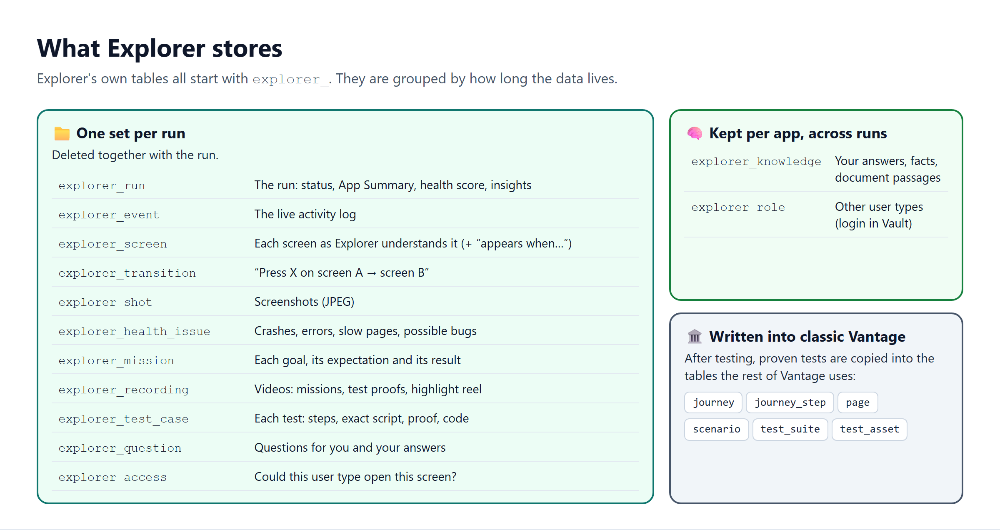
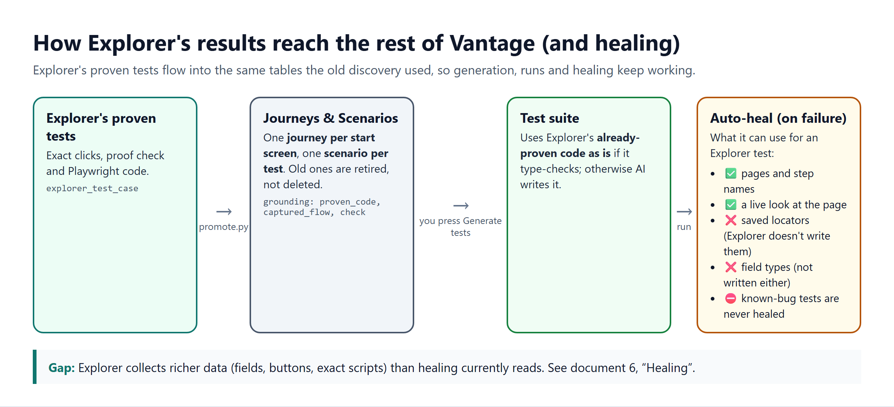

# 6. Data model

> **In short.** Explorer keeps everything it learns in its own tables, all named `explorer_…`, so the classic Vantage tables are left untouched. When testing finishes, proven tests are **copied** into the classic Journey / Scenario tables, in the same shape the old discovery used. Generation and runs work as before. Auto-heal works too, but it can use less of Explorer's data than it could (see §4).

**Contents:**
1. [The big picture](#1-the-big-picture)
2. [Each table](#2-each-table)
3. [What reaches the rest of Vantage](#3-what-reaches-the-rest-of-vantage)
4. [Healing: what it can and can't use](#4-healing-what-it-can-and-cant-use)
5. [Migrations](#5-migrations)

---

## 1. The big picture

- **Per run:** everything about one exploration. Deleted when the run is deleted.
- **Per app:** what Explorer has learned about the app (answers, documents, facts) and the extra user types. This is kept across all runs.
- **Ids:**
  - `id` is internal (UUIDv7).
  - `external_id` (UUIDv4) is the only id the API exposes.
  - `explorer_event` uses a running number, so the live feed can ask for "everything after event N".

All table definitions are in `packages/explorer_core/src/explorer_core/models.py`.

---

## 2. Each table

### `explorer_run`: one exploration

| Column | Purpose |
|---|---|
| `application_id` | FK to `application` (CASCADE) |
| `status`, `headline` | Lifecycle state and the one-line live text. See [document 3 §3](03-technical-flow.md#3-statuses). |
| `health_score`, `requirements_first` | 0–100. `requirements_first` is true when the score is below 60. |
| `brief` (JSONB), `brief_confirmed_at` | The App Summary and when you confirmed it. Includes `questions_for_you[].answer`, `key_tasks`, `focus` and `skip_screens`. |
| `notes` | Text from the Start card |
| `started_by_id` | Who to email when the run needs someone |
| `insights` (JSONB) | Stage 6 output: `unlinked`, `coverage`, `roles` |
| `branch_points` (JSONB) | Choices noticed during walk-throughs. These seed the branch missions. |
| `error` | One-line failure reason |

### `explorer_event`: the live feed

`kind` is one of thought, action, screen, health, phase, summary, error or question. The row also holds `title`, `detail`, an optional `shot_id` and `mission_id`. The UI polls `GET /runs/{id}/events?after=<last id>`.

### `explorer_shot`

Screenshot bytes (JPEG, viewport only, about 60–150 KB each). Served by `GET /explorer/shots/{id}`.

### `explorer_screen`: a screen as Explorer understands it

| Column | Purpose |
|---|---|
| `signature` | `subject\|view_kind\|mode`. This is the dedup key, so many URLs map to one row. |
| `name`, `entity`, `view_kind`, `mode`, `purpose` | Meaning |
| `url`, `url_pattern` | A sample URL, and the pattern with ids replaced by `{id}` |
| `fields`, `actions`, `hidden_hints` (JSONB) | What the screen offers |
| `visits`, `reached_by`, `shot_id` | Bookkeeping |
| `condition` | Set when the screen only appears in a situation ("`Married` is chosen", "Simulated: …", "nothing links to it"). This is what makes it a **hidden screen**. |

### `explorer_transition`: App Map edges

`from_screen_id`, `to_screen_id`, `action` (the label pressed) and an optional `mission_id`. The Screens tab shows them as "Press {action} → {screen}".

### `explorer_health_issue`

- `kind`: crash, broken_link, server_error, background_error, slow, wording, looks_wrong, or accepted (set after you say "correct").
- `severity`: high, medium or low.
- Also `title`, `detail`, `url`, `occurrences` and `shot_id`.
- `looks_wrong` issues are the **possible bugs**.

### `explorer_mission`: Mission Board entries

| Column | Purpose |
|---|---|
| `kind` | task, branch, area, rule or custom (added by you) |
| `title`, `goal`, `why`, `priority` (1–5), `instructions`, `start_screen` | The plan |
| `condition` | The situation a branch mission tests. New screens it finds inherit this condition. |
| `expected` | What **should** happen, written before the mission runs |
| `status`, `outcome`, `matches_expected`, `steps`, `new_screens` | The result |
| `added_by`, `started_at`, `finished_at` | Bookkeeping |

### `explorer_recording`

Video bytes. `kind` is one of:

- `mission`: webm, linked by `mission_id`;
- `proof`: webm, linked by `test_case_id`;
- `reel`: the MP4 highlight video.

Also stores `started_at` and `duration_seconds`.

### `explorer_test_case`

| Column | Purpose |
|---|---|
| `kind` | navigation, validation, error_state, data_load, form_submission, or page_quality (the non-AI checks) |
| `title`, `purpose`, `technique`, `business_thing`, `start_screen`, `steps` | For people |
| `expected`, `trust` | What should happen and where that belief comes from (confirmed, standard or seen) |
| `observed` | What the app actually did |
| `script` (JSONB) | Exact replayable actions. `script[0]` also holds metadata (how to run, rule, signed_out). |
| `check` (JSONB) | The proof: `{kind: text_visible \| url_contains, value}` |
| `status`, `drop_reason` | planned, building, proven, known_bug or dropped |
| `proof_runs`, `proof_passes`, `catches_breakage` | Proof statistics |
| `evidence_shot_id`, `code` | Screenshot and Playwright TypeScript |

### `explorer_question`

- `kind`: data, risk, rule or clarify.
- Also `question`, `why`, `options` (≤ 6), `shot_id`, and `mission_id`.
- `issue_id` links a "bug or correct?" question to its health issue.
- `status` is open, answered or dismissed; the row also holds `answer` and `answered_at`.

### `explorer_knowledge`: per-application memory across runs

- `kind`:
  - `answer`: your answers;
  - `fact`: typed by you or taken from run notes;
  - `doc`: a document passage;
  - `record`: test data the app showed.
- Also `text` (≤ 4,000 characters) and `source`.

### `explorer_role` and `explorer_access`

- `explorer_role` is another kind of user. It holds a `name` and a `secret_ref` pointing at the login in Vault.
- `explorer_access` holds one row per run × role × screen, with `allowed` and a `note`.

---

## 3. What reaches the rest of Vantage

The hand-off runs in `promote.py`, after testing finishes:

1. It takes every test with status `proven` or `known_bug`.
2. It groups them by **starting screen**. Each group becomes one **Journey**, keyed `explorer:<screen>`. Each test becomes one **Scenario**:
   - navigation, data loading and form submission tests are `happy`;
   - validation, error and page-quality tests are `negative`.
3. Each Journey gets a `Page` and `JourneyStep`. The screenshot is copied to the object store.
4. **On a re-run**, old scenarios, suites and assets are **retired** (`current = False`), never deleted. Journeys that no longer appear are marked `retired`.
5. The app's classic discovery record is marked complete.

Every Scenario carries a `grounding` JSON. This is the contract with the rest of Vantage:

| Key | What it holds | Who uses it |
|---|---|---|
| `proven_code` | Explorer's proven Playwright code | **Generation** uses it as is if it type-checks. Otherwise the AI writes new code. |
| `captured_flow` | The exact steps, as generator actions | Generation, as grounding |
| `requires_auth` | Whether the test needs sign-in | The spec linter (`@auth` tag) and the runner's sign-in |
| `check` | The proof (text or address) | Kept for reference |
| `explorer_test`, `kind`, `proven`, `one_at_a_time` | Links back to Explorer, plus run hints | Execution (`one_at_a_time` runs the tests one by one) |

Only three places outside Explorer's own tables are written to:

| Writer | Tables | Why |
|---|---|---|
| API `begin_run` | `discovery_run` | Classic screens show "Explorer is working" |
| Worker `promote.py` | `journey`, `journey_step`, `page`, `scenario`, `test_suite`, `test_asset`, `application.next_test_case_number`, `discovery_run` | The hand-off above |
| API roles endpoints | Vault | Store and delete extra user logins |

**The classic tables have not changed.** Explorer added no columns to them. `scenario.grounding` already existed (migration `b8d4f6a0c2e3`).

---

## 4. Healing: what it can and can't use

When a test fails in a run, **auto-heal** (`heal_test_activity` in `apps/workers/execution/src/execution_worker/activities.py`) tries to repair it. It reads four things. For an Explorer test:

| What heal reads | Comes from | For an Explorer test |
|---|---|---|
| Known pages (address + step name) | `page`, `journey_step` | ✅ Available |
| A live look at the page (live inspection) | The running app | ✅ Available |
| Saved locators (stable ways to find each button or field) | `component`, `component_locator` | ❌ **Empty**: Explorer doesn't write these |
| Field input types (number vs text) | `form`, `form_field` | ❌ **Empty**: Explorer doesn't write these |

Known-bug tests (`test.fixme`) are **never healed**, because healing would erase the bug they record.

**The gap.** Explorer collects richer data than the old crawler did. It knows each screen's fields and buttons, the exact recorded clicks, the proof, and where each action leads. But that data sits in `explorer_*` tables and in `grounding`, which healing doesn't read. For Explorer tests, healing relies on the AI plus the live look only. The existing auto-heal may also rewrite Explorer's proven code after a failed run.

**Two ways to close it:**
1. Have `promote.py` also fill `component`, `component_locator`, `form` and `form_field` from Explorer's screen data. The locators would be label- or role-based, the same style Explorer's tests already use. Every reader of those tables would then benefit. **This is the recommended option.**
2. Teach healing to read `grounding.captured_flow` and `grounding.check` for Explorer scenarios. This is a smaller change, but it only helps healing.

---

## 5. Migrations

Applied in this order (Alembic, `migrations/versions/`):

| Revision | File | Adds |
|---|---|---|
| `e7a1c3b5d9f2` | `add_explorer_tables` | run, event, shot, screen, health_issue (Stage 1) |
| `f3b5d7e9a1c4` | `add_explorer_missions_map_recordings` | mission, transition, recording; `run.branch_points`, `screen.condition`, `event.mission_id` (Stage 2) |
| `a4c6e8f0b2d5` | `add_explorer_test_cases` | test_case; `recording.test_case_id`, with `mission_id` made nullable (Stage 5) |
| `b5d7f9a1c3e6` | `add_explorer_questions_knowledge` | question, knowledge (Stage 4) |
| `c6e8a0b2d4f7` | `add_explorer_roles_insights_reel` | role, access; `run.insights`, `recording.kind` (Stages 6–7) |
| `d7f9b1c3e5a8` | `add_explorer_run_started_by` | `run.started_by_id` → `platform_user` |

The chain starts after `b8d4f6a0c2e3` (`add_scenario_grounding`), and `d7f9b1c3e5a8` is currently the head.
