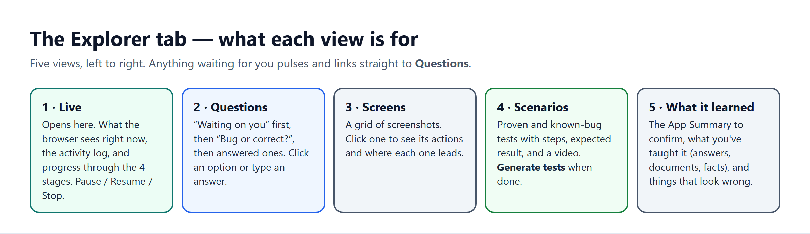

# 7. API and web UI

> **In short.**
> - **Explorer tab:** five views, in this order: **Live**, **Questions**, **Screens**, **Scenarios** and **What it learned**. They refresh by asking the API for news every 1.5–2.5 seconds while a run is working.
> - **API:** 34 endpoints under `/explorer`. Only four of them touch Temporal: start, confirm, pause/stop, and resume. All the others read or write the database.

## Part A: the `/explorer` API

File: `apps/api/src/api/explorer.py`. The router is `APIRouter(prefix="/explorer")`, mounted in `apps/api/src/api/main.py`.

**Auth:** every endpoint takes `CurrentOrgIdDep` and checks ownership by joining to `Application.organization_id`. Anything from another organization returns 404. There are no role-level checks.

### Runs

| Method | Path | What it does | Temporal |
|---|---|---|---|
| GET | `/applications/{app_id}/runs/latest` | Newest run with counts, or `null` | – |
| POST | `/applications/{app_id}/runs` | Start a run (`{notes?}`) → `begin_run`. Returns 409 if one is active, 503 `EXPLORER_UNAVAILABLE` if no worker. | start, mode `full` |
| GET | `/runs/{run_id}` | Run with counts (screens, hidden screens, health issues, missions, tests, open questions) | – |
| GET | `/runs/{run_id}/events?after=&limit=` | Feed events with `id > after` (limit 1–500, default 200) | – |
| PUT | `/runs/{run_id}/brief` | Replace the App Summary. Only while `awaiting_confirmation`. | – |
| POST | `/runs/{run_id}/confirm` | Confirm the summary; stores answered summary questions as knowledge | signal `brief_confirmed` |
| POST | `/runs/{run_id}/stop` | Status `stopped` | cancel |
| POST | `/runs/{run_id}/pause` | Status `paused` | cancel |
| POST | `/runs/{run_id}/resume` | From paused, stopped or failed | terminate leftover, then start mode `resume` |

### What Explorer found

| Method | Path | What it does |
|---|---|---|
| GET | `/runs/{run_id}/screens` | Screens, oldest first |
| GET | `/runs/{run_id}/map` | `{screens, edges(from_id, to_id, action)}` |
| GET | `/runs/{run_id}/health` | Issues sorted by severity, then occurrences |
| GET | `/shots/{shot_id}` | JPEG (private cache, 1 day) |
| GET | `/runs/{run_id}/report` | Hidden screens, possible bugs, known-bug tests, tests by kind, missions, access chart, insights, `has_reel` |
| GET | `/runs/{run_id}/report/download` | A self-contained HTML report with screenshots inlined as base64 |
| GET | `/runs/{run_id}/reel` | Highlight MP4 |

### Missions

| Method | Path | What it does | Temporal |
|---|---|---|---|
| GET | `/runs/{run_id}/missions` | Ordered by priority, with recording info | – |
| POST | `/runs/{run_id}/missions` | Add your own mission (`{goal, title?}`). It gets kind `custom` and priority 5. Allowed while planning, exploring or explored. | if the run was `explored`: start mode `missions` |
| POST | `/missions/{mission_id}/skip` | Queued or running → `skipped`. The worker notices it in the DB. | – |
| GET | `/missions/{mission_id}/recording` | Mission webm | – |

### Test cases

| Method | Path | What it does | Temporal |
|---|---|---|---|
| GET | `/runs/{run_id}/tests` | Tests (without `script`), plus `has_proof_video` | – |
| GET | `/tests/{test_id}/proof` | Proof webm | – |
| GET | `/runs/{run_id}/tests/download` | ZIP: the project scaffold plus `tests/<kind>/<title>.spec.ts` for proven and known-bug tests | – |
| POST | `/runs/{run_id}/tests/regenerate` | Deletes the run's tests and writes and proves them again. Allowed once explored, tested, or stopped after confirmation. | terminate leftover, then start mode `tests` |

### Questions and memory

| Method | Path | What it does |
|---|---|---|
| GET | `/runs/{run_id}/questions` | Newest first, with the mission title |
| POST | `/questions/{question_id}/answer` | Stores the answer and adds an `explorer_knowledge` answer row. For a `rule` question linked to an issue: "It's correct…" marks the issue `accepted`; anything else makes it high severity ("Confirmed bug"). **No Temporal signal is sent**: the waiting mission polls the DB. |
| POST | `/questions/{question_id}/dismiss` | Open → dismissed. The waiting mission carries on without an answer. |
| GET | `/applications/{app_id}/knowledge` | Everything Explorer knows about the app |
| POST | `/applications/{app_id}/knowledge` | Add a fact (`{text}`) |
| POST | `/applications/{app_id}/knowledge/documents` | Upload a document (see below) |
| DELETE | `/knowledge/{knowledge_id}` | Forget one item |

**Document upload:**

- **Formats:**
  - PDF, read with `pypdf`;
  - `.docx`, read with `zipfile` + regex, with no docx library;
  - `.txt`, `.md` and `.csv`, decoded as UTF-8.
- **Limits:**
  - maximum size 15 MB;
  - the text is split into passages of about 1,500 characters;
  - at most 40 passages are kept.
- **Storage:** each passage becomes an `explorer_knowledge` row of kind `doc`, with `source` set to the file name.

### Roles (who can see what)

| Method | Path | What it does |
|---|---|---|
| GET | `/applications/{app_id}/roles` | Role names only. Secrets are never returned. |
| POST | `/applications/{app_id}/roles` | `{name, username, password}`. The login is stored in Vault; only `secret_ref` is kept in the database. |
| DELETE | `/roles/{role_id}` | Deletes the Vault secret, then the row |

### Classic discovery integration

- `apps/api/src/api/discovery.py`: `EXPLORER_REPLACES_DISCOVERY` (default `"1"`). When it is on, `start_discovery_run` for a new app calls `begin_run`. Classic *resume* still uses the crawler.
- `ApplicationRead.discovery_engine` is `"explorer"` if the app has any Explorer run, otherwise `"crawler"`. The web app uses it to decide which pages to show.

---

## Part B: the Explorer tab

Folder: `apps/web/src/explorer/`. The API client is in `explorerApi.ts`.

### Where it lives in the app

`App.tsx` adds an **Explorer** tab to every application. When `discovery_engine === 'explorer'`:

- the **Journeys** and **Scenarios** tabs are removed from the sidebar. Their rows still exist underneath and test generation reads them;
- navigating to `journeys` or `scenarios` redirects to `explorer`;
- the app opens on Explorer unless suites already exist;
- Overview's quick actions show **Open Explorer**;
- `DiscoverJourneys` and `ReviewScenarios` show "Explorer is finding this app's journeys" / "Scenarios appear here once Explorer has proven its tests" instead of crawler controls.

### Polling model (`ExplorerTab.tsx`)

| Data | When it refreshes |
|---|---|
| Feed events | Every **1.5 s** while the run is working, using an `after=<last id>` cursor and paging until a page has fewer than 200 rows |
| Run (status and counts) | Every **2.5 s** while working. The view auto-switches to *What it learned* when the status becomes `awaiting_confirmation`. |
| Health, questions, map, missions, tests | Only when the matching **count** on the run changes (no timer) |

"Working" means queued, signing_in, understanding, summarizing, confirmed, planning, exploring, hunting or testing. Polling stops while the run waits for confirmation, after it finishes, and while it is paused.

### Header

Title, app identity and the live headline. Buttons:

- **Pause** and **Stop** while working;
- **Resume** when the run is paused, stopped or failed, with a banner explaining why it didn't finish;
- **New run** otherwise. This opens the **Start card**: six explainer tiles, a roles panel for adding other kinds of users, and **Start exploring**.

### Tabs, in order

| Tab | Component | What the user sees | Main calls |
|---|---|---|---|
| **Live** (default) | `LiveView.tsx` | See the list below. | none of its own (props) |
| **Questions** | `QuestionsView.tsx` | See the list below. | `answer`, `dismiss`, `addFact`, `uploadDocument`, `deleteKnowledge` |
| **Screens** | `ScreensView.tsx` | A screenshot grid, paged 48 at a time. Filters: "All" and "Something looks wrong". Search. Clicking a screen opens a drawer with its screenshot and **"From this screen"**: each action and where it leads, clickable. There is no graph view. | none (uses `map`) |
| **Scenarios** | `ScenariosView.tsx` | Tests grouped by start screen; dropped tests are hidden. Stats: "work as they should", "show a bug", "still being tried", "from what you told Explorer". Kind filter chips. Each test card shows steps, "Should happen", "The app did", replay stats, the evidence shot and **Watch it run** (proof video). **Generate tests** appears once the run is `tested` and hands over to the suite tab. | `tests`, `proofUrl` |
| **What it learned** | `SummaryView.tsx` + `KnowledgePanel` + `HealthView.tsx` | The App Summary (app name, one-liner, questions, key tasks, goal for this run, screens to leave out), with Edit and **Looks right — confirm**. Then the knowledge panel. Then **"Things that look wrong"**, folded, last. | `saveBrief`, `confirm`, `answer` |

**Live** shows:

- a **"Waiting for you"** box, pulsing, with **Answer now** or **Check the summary**;
- the live browser: the latest screenshot, its URL, and the running mission;
- a "Just visited" strip;
- the activity log (newest first, 80 entries, thoughts hidden);
- a progress panel with 4 stages: Learning the app → Your check → Trying every path (with the mission list and **Skip**) → Writing scenarios.

**Questions** has three groups:

- "Explorer is waiting on these" (pulsing);
- "Bug or correct?" (never blocking);
- "Answered" (folded).

Each card shows a screenshot, option buttons, a free-text answer, and Skip.

### UI rules applied across the tab

These come from the project's `CLAUDE.md` and are reflected in the components:

- Not information-heavy. Secondary content is folded ("Show all", accordions); findings come last and folded.
- Anything waiting on the user pulses (`explorer-attention`). The Live box links straight to Questions.
- "Is this a bug?" questions never block and never show as "Waiting for you".
- An answer visibly changes the UI: `refreshAfterAnswer` reloads questions, run and health.
- No model guesses about the business are shown.
- No map or graph views: screens are a screenshot grid.
- Loading buttons use the ring `Spinner`.

### Client calls defined but not used by the UI today

`explorerApi.ts` defines these, but no component calls them:

- `addMission`
- `regenerateTests`
- `report`
- `reelUrl`
- `reportDownloadUrl`
- `testsDownloadUrl`
- `recordingUrl`

The endpoints exist and work. The UI to add missions, regenerate tests, show the report, or download the ZIP, report or video was folded away when the tab was simplified.
